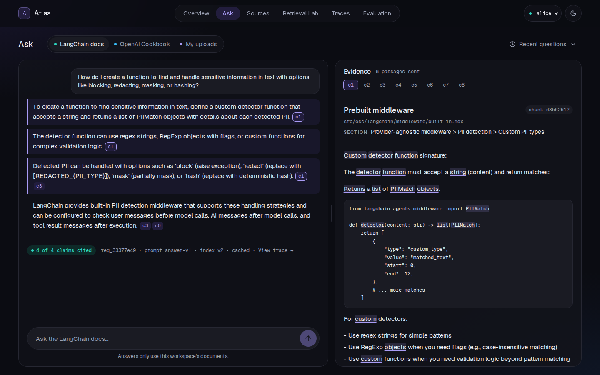

# Atlas

**An evidence-first RAG assistant. Every claim in an answer cites the doc passage behind it, and when the docs don't cover a question it says "Not enough evidence" instead of guessing.**

Atlas indexes two pinned documentation sets, the **LangChain docs** and the **OpenAI Cookbook**, plus anything you upload (PDF or Markdown). It searches with BM25, vectors and a hybrid of both, answers with gpt-4.1-mini in strict JSON, and drops any claim whose citation does not point at a passage it was given.



> **Unofficial.** Independent portfolio project, not affiliated with or endorsed by LangChain or OpenAI. Both corpora are MIT-licensed; see [NOTICE.md](NOTICE.md).

## What's inside

| Page | What it does |
|---|---|
| **Overview** | What Atlas is, one real cited answer next to its passage, and the measured holdout numbers. |
| **Ask** | Ask a question in one workspace. Each claim ends in citation chips; click one to read the passage, with the words it shares with the claim underlined. Abstentions, refusals and replay mode each have their own state. |
| **Sources** | Every document with its license, sha and chunk count; the last index update (added / removed / unchanged chunks); upload in "My uploads". |
| **Retrieval Lab** | One question, three ranked columns (BM25, Dense, Hybrid). Labeled questions mark their expected passage in each column. |
| **Traces** | Per request: stage timings, prompt and index versions, which chunks were retrieved, sent or dropped, and the citation checks. |
| **Evaluation** | The committed holdout and tuning runs: Recall@5 with its interval, answer outcomes, leaks, latency, per-class results and a failures-only table. |

Two demo users show server-side access control: **alice** (LangChain, Cookbook, My uploads) and **bob** (Cookbook only). Switch in the top right.

## Results

> **Labels: LLM-drafted, cross-checked by a second model (Claude), not hand-checked.** GPT-4.1-mini drafted the 120 questions and their gold passages; Claude then reviewed every one ([docs/labeling_guide.md](docs/labeling_guide.md)): 80 kept, 27 gold sets fixed, 13 dropped. Full discussion: [docs/analysis.md](docs/analysis.md).

Holdout retrieval, 42 answerable questions ([run](runs/retrieval/20261103T114450Z-holdout)):

| Method | Recall@5 [95% CI] | MRR@10 |
|---|---|---|
| BM25 | 0.833 [0.714, 0.929] | 0.778 |
| Dense (text-embedding-3-small) | 0.905 [0.810, 0.976] | 0.854 |
| Hybrid (RRF, k=60) | 0.929 [0.833, 1.000] | 0.895 |

- BM25 found every exact API name (Recall@5 1.000 on exact_id); Dense was best on pages that are new since Sep 2025 (0.933 vs BM25 0.600).
- Hybrid is best overall but not significantly better at this size (McNemar, Holm p 0.44 vs BM25, 1.0 vs Dense).

Holdout answers, 74 questions ([run](runs/answers/20261103T114451Z-holdout)):

| Measure | Result |
|---|---|
| Right outcome (answer if answerable, abstain if not) | 95.9% |
| Correct abstentions (unanswerable + other-workspace questions) | 31 of 32 |
| Answerable questions wrongly abstained | 2 of 42 |
| Claims shown with a valid citation | 100% |
| Claims supported by their cited passage (Claude judge / GPT judge) | 93.8% / 98.3% of 178 |
| Cross-workspace leaks | 0 |
| Latency p50 / p95 (live run) | 1.35 s / 2.99 s |
| Cost of the live 80-question run | $0.075 |

Docs update: going from the Sep 2025 LangChain snapshot to the Nov 2026 one changed **+1,226 / −557 / 76 unchanged** chunks; the removed chunks are deleted from the index and the vector store. Re-ingesting the same snapshot changes nothing.

## Quick start (Docker, no API key needed)

```bash
git clone https://github.com/shisukeUrahara/atlas && cd atlas
docker compose up --build -d          # web on 127.0.0.1:3000 (set ATLAS_PORT to change)
docker compose exec web pnpm atlas ingest --corpus langchain-old
docker compose exec web pnpm atlas ingest --corpus langchain
docker compose exec web pnpm atlas ingest --corpus cookbook
```

Open http://localhost:3000. Without a key Atlas runs in **replay mode**: search (all three methods) and every question in the evaluation set replay from the committed caches; a new question gets a clear "not cached" message.

## Local development

Needs Node 24 and pnpm 10.

```bash
pnpm install
pnpm atlas ingest --corpus langchain-old && pnpm atlas ingest --corpus langchain && pnpm atlas ingest --corpus cookbook
pnpm build && PORT=3010 pnpm start    # or: pnpm dev
```

### Environment variables (`.env`, see `.env.example`)

| Variable | Meaning |
|---|---|
| `OPENAI_API_KEY` | Empty = replay mode (cache only). Set it to answer new questions and embed new chunks. |
| `ATLAS_MODEL` | Answer model. Default `gpt-4.1-mini-2025-04-14`. |
| `ATLAS_QDRANT_URL` | Qdrant URL for vectors. Empty = in-process vector store (enough for these corpora). |
| `ATLAS_DATA_DIR` | Folder holding `fixtures/ cache/ runs/ data/`. Default: current folder. |
| `ATLAS_PORT` | Host port for Docker compose. |

## How it works

```
fetch (pinned commit, sha256) → clean MDX / notebooks → heading-aware chunks (content-hash ids)
  → SQLite index with versions → BM25 + embeddings (cached) → hybrid RRF
  → token-budgeted context [c1..cn] → strict JSON answer → citation check → answer or abstain
```

- **Chunk ids** are a hash of (workspace, path, heading, text), not of the commit, so an unchanged paragraph keeps its id across doc versions and an update is an exact diff ([ADR 0001](docs/adr/0001-chunking-and-versions.md)).
- **Workspaces** are enforced on the server: every store read and vector search takes the workspace the server derived from the user, never one from the request or the model ([ADR 0002](docs/adr/0002-server-side-workspace-filter.md)).
- **Citations** must name a passage label that was actually sent; a claim left without one is dropped, and an answer with no supported claim becomes an abstention.
- **Evaluation** runs are folders with a manifest, per-question results, scores and checksums; holdout runs need a clean tree ([ADR 0003](docs/adr/0003-evaluation-protocol.md)).

Project layout and a reading order: [docs/CODE_TOUR.md](docs/CODE_TOUR.md). What happened while building it: [docs/build_log.md](docs/build_log.md).

## Command line (`pnpm atlas <command>`)

| Command | What it does |
|---|---|
| `fetch --corpus <name>` | Download the pinned files (and the snippets they import) with sha256s |
| `chunk --corpus <name>` | Clean and chunk into `fixtures/<name>/chunks.jsonl` |
| `verify` | Check every snapshot file against its manifest (also in CI) |
| `ingest --corpus <name>` | Sync a workspace to a snapshot: skip unchanged, diff changed, remove gone |
| `embed` | Embed every chunk into the cache |
| `draft-questions`, `judge-pool`, `replace-flagged`, `build-questions` | Build the 120-question set |
| `review-sheet`, `apply-review` | Owner review of the labels |
| `eval --split …`, `eval-answers --split …`, `judge-claims` | Evaluation runs |
| `gate` | Replay the tuning runs exactly and check the quality floor (in CI) |

## Tests

```bash
pnpm test        # 305 unit and route tests (Vitest)
pnpm e2e         # 96 browser tests at 390 / 768 / 1440 px, axe in light and dark (Playwright)
pnpm atlas gate  # tuning evals replay from cache and meet the floor
```

## Reproduce the evaluation

With a key, from a clean checkout:

```bash
pnpm atlas embed
pnpm atlas eval --split holdout && git add runs && git commit -m "retrieval holdout"
pnpm atlas eval-answers --split holdout
```

With no key the same commands replay from `cache/`, and `pnpm atlas gate` checks the tuning runs match exactly.

## Known limits

- Labels are LLM-drafted and cross-checked by a second model; no person checked them.
- One run per configuration at temperature 0: no run-to-run variance measured.
- Equal-weight RRF can dilute one confident method when the other finds nothing (3 holdout misses).
- The citation check proves a cited passage was sent, not that it supports the claim (one holdout answer cited off-topic passages).
- The highlight in the evidence panel marks shared words, not proof of support.
- Demo users are fixed identities (authorization, not authentication). Uploads are processed in-process.
- `node:sqlite` is marked experimental in Node 24.

## License and sources

Code: MIT ([LICENSE](LICENSE)). LangChain docs (`langchain-ai/docs`) and OpenAI Cookbook (`openai/openai-cookbook`) are MIT; their license files are kept next to each snapshot, and every chunk links to its pinned source file. All evaluation questions are synthetic. See [NOTICE.md](NOTICE.md).
